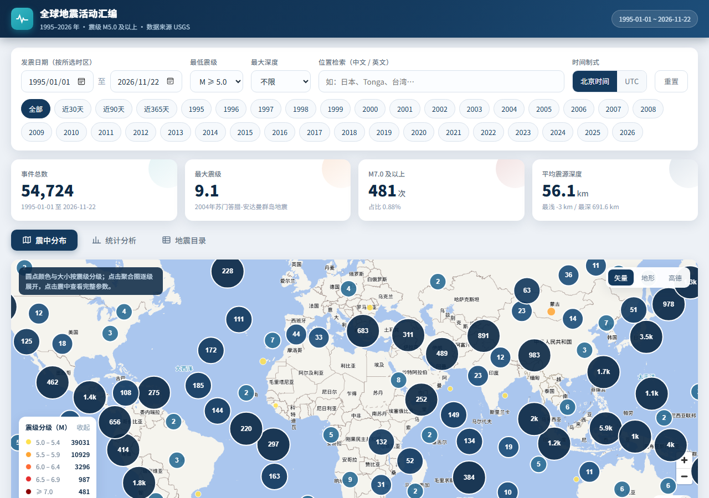
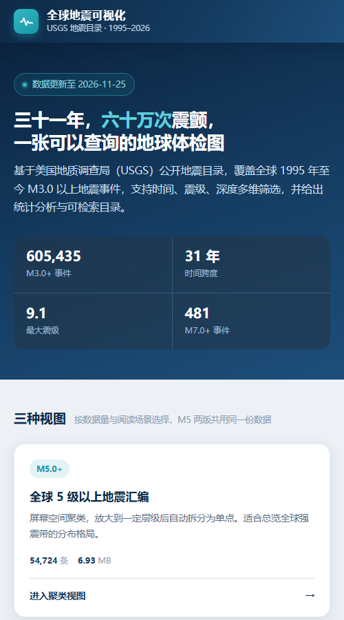

# 全球地震可视化 · Global Earthquake Visualization

基于美国地质调查局（USGS）公开地震目录的 **1995–2026 全球地震交互地图**。纯静态、无后端、无构建工具，既可在线访问，也能以单文件离线分发。

[**在线访问**](https://earthquakevisualization.top) · [数据来源](#数据) · [本地运行](#本地运行) · [部署](#部署)




移动端（500 px 视口）：



## 三种视图

| 视图 | 数据量 | 渲染方式 | 适合场景 |
|---|---|---|---|
| 5 级以上地震汇编 | 54,724 | 屏幕空间聚类（46 px） | 总览全球强震带格局 |
| 5 级以上地震点状图 | 54,724 | 全点状，震级分桶 | 看单次事件的相对位置 |
| 3 级以上地震点状图 | 605,435 | 全点状（18 字节/条二进制解码） | 看清板块边界的细节 |

## 功能

- **多维筛选**：日期区间、最低震级、最大深度、中英文地名检索，含近 30/90/365 天与按年快捷选项
- **KPI 联动**：事件总数、最大震级、M7.0+ 占比、平均震源深度及极值
- **七档震级图例**：颜色与点半径随震级分级，计数实时联动
- **点选详情**：震级与类型、北京时间/UTC 时间、经纬度、震源深度
- **统计分析**：ECharts 图表视图 + 可检索地震目录（Top 10）
- **底图切换**：天地图矢量 / 天地图地形 / 高德
- **全屏地图**：一键铺满整个屏幕，`Esc` 或再点一次退出，进出都会重算画布尺寸
- **每日自动同步**：GitHub Actions 每天 09:17（北京时间）抓取 USGS 最新地震，提交后由 Cloudflare 自动重新部署；页面加载时并入比内联数据更新的记录，地图下方显示同步条数
- **站点公告**：首页右上角「公告」入口，有未读公告时显示红点；内容来自 `site/data/notice.json`，用 `scripts/add_notice.py` 追加即可发布
- **移动端适配**：响应式布局与触控事件

## 技术要点

- **MapLibre GL 4.7.1 + ECharts 5.5.1**，纯原生 JavaScript，无框架、无打包
- **主线程 Canvas 叠加层**：放弃 GeoJSON 数据源，改为在地图容器上叠加透明 Canvas 绘制全部震点。部分移动内核（微信内置浏览器等）在 Web Worker 中加载 GeoJSON 会永久挂起——源存在、渲染为 0、无报错
- **屏幕空间网格聚类**：46 px 半径，重叠聚类合并去重，点击逐级放大
- **Path2D 分块**：单个 Path2D 子路径超过 6 万即拆分，规避 Skia 路径上限导致的整桶零绘制；严格按震级由低到高填充，保证高震级点在最上层
- **二进制压缩**：M3 数据按固定 18 字节/条（`<IHiihBB`）存储，60 万条压到约 10.4 MB
- **每日增量的数据管道**：`scripts/fetch_recent.py` 只拉上次同步点之后的事件，与 `site/data/recent-*.json` 合并去重、滚动保留 30 天；页面按时间戳去重并入内存数据，不改动内联的历史数据
- **网页版拆包**：网页把数据外置成 `/data/eq-m5.json`（6.9 MB）与 M3 的「近 5 年 / 更早历史」两段二进制，页面外壳只有 81–88 KB，首屏先出界面骨架，XHR 带进度条加载数据；聚类版与点状版共用同一份数据文件
- **M3 渐进加载**：默认只拉近 5 年（1.8 MB，10.4 万条），页面上提供「加载 1995–2020 完整历史（8.6 MB）」按钮，点了才下载早期数据。M3 从 ArrayBuffer 直接解析，省掉 Base64 与 1000 万次字符转换

## 目录结构

```
.
├── site/                      可直接部署的站点（Cloudflare Workers / Pages / Nginx / OSS）
│   ├── index.html             首页
│   ├── m5-cluster.html        5 级以上 · 聚类版
│   ├── m5-points.html         5 级以上 · 点状版
│   ├── m3-points.html         3 级以上 · 全量点状版
│   ├── 404.html               自定义错误页
│   ├── download/              离线单文件版
│   ├── data/                  外置数据（M5 JSON / M3 分段二进制 / 每日增量 / 公告）
│   ├── robots.txt · sitemap.xml · _headers
├── scripts/                   数据抓取、打包、构建与地名处理
│   ├── download_usgs.py       M5 下载（按月分块，超限自动二分）
│   ├── download_usgs_m3.py    M3 下载（可重入）
│   ├── build_dataset.py       M5 紧凑 JSON
│   ├── build_m3_pack.py       M3 二进制 Base64 包
│   ├── build_web.py           网页版：外壳 + 外置数据（M3 分段）
│   ├── add_notice.py          发布站点公告
│   ├── build_html.py / build_html_allpoints.py / build_html_m3.py
│   ├── page_template.html / page_template_m3.html
│   └── place_translate.py     中文地名词典
├── data/                      处理后的数据（原始 GeoJSON 不入库，见下方说明）
├── docs/部署方案总览.md        线上跑在哪些服务上、免费额度、风险、搬家路径
├── docs/部署步骤.md            从零到上线的逐步操作手册
├── .github/workflows/          每日同步最新地震的 GitHub Actions
├── wrangler.jsonc             Cloudflare Workers 静态资源配置
├── package.json               wrangler 依赖与脚本
├── 项目说明.md
└── 网站实施路径.md            从单文件到网站的完整方案
```

## 数据

| 数据集 | 记录数 | 最大震级 | M7.0+ | 平均震源深度 |
|---|---|---|---|---|
| M3.0+（1995–2026） | 605,435 | 9.1 | 481 | 67.4 km |
| M5.0+（1995–2026） | 54,724 | 9.1 | 481 | 56.1 km |

- 来源：USGS FDSN Event Web Service（`earthquake.usgs.gov/fdsnws/event/1/query`），GeoJSON，`orderby=time-asc`
- 单次查询上限 2 万条（超限 400），故按月分块、超限二分、按年汇总
- 以事件编号去重；`minmagnitude=3.0` 下偶发返回的低于 3.0 事件按实测震级二次剔除
- 时间覆盖：1995-01-01 至 2026-11-25

**为什么仓库里没有原始 GeoJSON**：`data/m3/` 有 32 个年度文件、约 449 MB，`data/usgs_m5_*.geojson` 另有约 40 MB。它们可由 `scripts/download_usgs*.py` 完整重抓，放进 Git 只会让仓库膨胀且拖慢克隆。仓库保留的是处理后的紧凑 JSON（约 25 MB），足以直接重建页面。

## 本地运行

站点是纯静态的，任意静态服务器即可：

```bash
cd site
python -m http.server 8080
# 打开 http://127.0.0.1:8080
```

## 重新构建

环境：Python 3.8+（仅 `build_dataset.py` 需要 `openpyxl`），下载脚本只用标准库。

```bash
# 1. 抓取原始数据（可重入，已存在的年份自动跳过）
python scripts/download_usgs.py
python scripts/download_usgs_m3.py

# 2. 打包
python scripts/build_dataset.py
python scripts/build_m3_pack.py

# 3. 生成 HTML
python scripts/build_html.py
python scripts/build_html_allpoints.py
python scripts/build_html_m3.py
```

> 脚本里的路径是绝对路径（`D:\LZSY\地震汇编`），换机器运行时需改成实际路径。

## 发布公告

首页右上角「公告」的内容来自 `site/data/notice.json`，用脚本追加：

```bash
python scripts/add_notice.py --type feature --title "标题" --body "正文"
python scripts/add_notice.py --list          # 查看现有公告
python scripts/add_notice.py --remove <id>   # 删除某条
```

`--type` 可选 `feature`（新功能）/ `data`（数据）/ `maintenance`（维护）/ `other`（其他），决定标签颜色。

改完提交推送即可，Cloudflare 会自动部署；公告接口缓存 5 分钟，所以最多 5 分钟后全站可见。有未读公告时首页按钮会显示红点，用户点开一次后红点消失（记在浏览器本地）。

## 部署

站点目录 `site/` 可直接拖到任意静态托管：

- **Cloudflare Workers 静态资源**（当前使用）：`wrangler.jsonc` 指定 `./site`，连 GitHub 后 `git push` 即自动部署。静态资源请求免费且不限量
- **Cloudflare Pages**：Create → Connect to Git → Build command 留空 → 输出目录 `site`
- **Nginx**：`root` 指向 `site/`，开启 `gzip_static`，HTML 短缓存、数据长缓存
- **对象存储**：阿里云 OSS / 腾讯云 COS 静态网站托管（自定义域名需备案）

细化的额度、DNS、风险与搬家路径见 [`docs/部署方案总览.md`](docs/部署方案总览.md)。

> 页面通过 CDN 加载 MapLibre 与 ECharts（jsDelivr），底图为天地图/高德在线瓦片，因此终端需联网。完全离线请用 `site/download/` 下的单文件版。

## 已知限制

- 天地图密钥为浏览器端 key，若绑定域名白名单，换域名后需要重新配置
- 13.93 MB 的 M3 页面在弱网下首屏较慢，后续计划拆分为「页面壳 + 外置数据 + 进度条」

## 致谢与引用

数据来自 [USGS Earthquake Hazards Program](https://earthquake.usgs.gov/)；底图来自 [天地图](https://www.tianditu.gov.cn/) 与 [高德](https://www.amap.com/)；地图引擎 [MapLibre GL JS](https://maplibre.org/)，图表 [Apache ECharts](https://echarts.apache.org/)。

引用信息见 [`CITATION.cff`](CITATION.cff)。

## 许可

- **代码**：MIT，见 [`LICENSE`](LICENSE)
- **地震数据**：USGS 作品属美国联邦政府公有领域，可自由使用
- **地图底图**：版权归天地图、高德所有，使用须遵守各自服务条款

> 本项目仅用于学习、科研与教学展示，**不构成地震预报或预警**。
